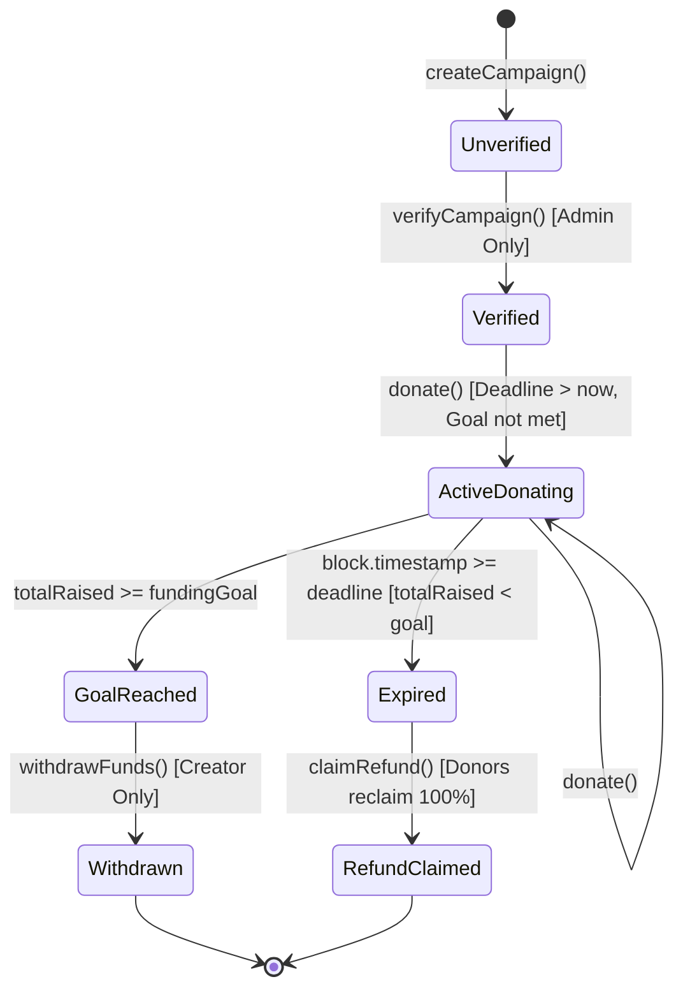

# Smart Contract Architecture & Design — TrustLedger

**Course Project:** Mini Project - Develop a Blockchain based application for transparent and genuine charity  
**Contract Name:** `CharityPlatform.sol`  
**Solidity Compiler Version:** `^0.8.20`  
**License:** MIT  

---

## 1. System Overview

`CharityPlatform` is a decentralized Ethereum smart contract that manages charitable fundraising campaigns through cryptographic escrow. It enforces algorithmic rules that eliminate human discretion in financial accounting, milestone requirements, and donor refunds.

### Core Guarantees:
1. **Immutable Registration:** Campaigns cannot be altered or deleted once recorded on-chain.
2. **Access-Controlled Approval:** Only campaigns verified by the platform administrator can accept incoming test ETH donations.
3. **Escrow Custody:** Donated funds are locked inside the contract balance until explicit release conditions are met.
4. **All-or-Nothing Funding Rule:** Campaign creators can only withdraw funds if the total donations reach or exceed the defined `fundingGoal`.
5. **Donor Refund Guarantee:** If a campaign's deadline expires without reaching its funding target, donors can reclaim 100% of their contributions directly from the contract.
6. **Reentrancy Protection & Safe Transfers:** All state changes occur before external ether transfers, adhering to the Checks-Effects-Interactions pattern.

---

## 2. Campaign Lifecycle State Machine



---

## 3. Data Structures

### `Campaign` Struct

```solidity
struct Campaign {
    uint256 id;              // Unique identifier (1-indexed)
    string title;            // Title of campaign
    string description;      // Detailed purpose & scope
    address payable creator; // Address of campaign creator
    uint256 fundingGoal;     // Target amount in wei
    uint256 totalRaised;     // Sum of all donations in wei
    uint256 deadline;        // Unix timestamp in seconds
    bool verified;           // True only after admin approval
    bool withdrawn;          // True when creator withdraws funds
    bool exists;             // Guard flag confirming valid entry
}
```

### State Storage & Mappings

- `address public immutable admin`: Platform administrator address set at contract construction.
- `uint256 public campaignCount`: Running counter of total campaigns created.
- `mapping(uint256 => Campaign) public campaigns`: Main ledger mapping campaign IDs to campaign records.
- `mapping(uint256 => mapping(address => uint256)) public contributions`: Nested mapping tracking the exact wei contributed by each donor to each campaign.
- `mapping(uint256 => address[]) private campaignDonors`: Array of unique donor addresses for each campaign to provide donor transparency.

---

## 4. Solidity Events

Every state transition emits an indexed event to allow off-chain indexers and user interfaces to track actions in real time:

- `event CampaignCreated(uint256 indexed id, address indexed creator, string title, uint256 fundingGoal, uint256 deadline)`
- `event CampaignVerified(uint256 indexed id, address indexed admin, uint256 timestamp)`
- `event DonationReceived(uint256 indexed id, address indexed donor, uint256 amount, uint256 newTotalRaised, uint256 timestamp)`
- `event FundsWithdrawn(uint256 indexed id, address indexed creator, uint256 amount, uint256 timestamp)`
- `event RefundClaimed(uint256 indexed id, address indexed donor, uint256 amount, uint256 timestamp)`

---

## 5. Security & Design Patterns

### Checks-Effects-Interactions Pattern
To protect against reentrancy attacks, the contract always modifies internal state before making external Ether transfers:

#### Example in `withdrawFunds`:
```solidity
// 1. Checks
require(msg.sender == campaign.creator, "Only creator");
require(campaign.totalRaised >= campaign.fundingGoal, "Goal not reached");
require(!campaign.withdrawn, "Already withdrawn");

// 2. Effects
uint256 amount = campaign.totalRaised;
campaign.withdrawn = true;

// 3. Interactions
(bool sent, ) = campaign.creator.call{value: amount}("");
require(sent, "Transfer failed");
```

#### Example in `claimRefund`:
```solidity
// 1. Checks
require(block.timestamp >= campaign.deadline, "Deadline not passed");
require(campaign.totalRaised < campaign.fundingGoal, "Goal met");
uint256 refundAmount = contributions[_campaignId][msg.sender];
require(refundAmount > 0, "No eligible contribution");

// 2. Effects (Zero balance before sending)
contributions[_campaignId][msg.sender] = 0;

// 3. Interactions
(bool sent, ) = payable(msg.sender).call{value: refundAmount}("");
require(sent, "Refund transfer failed");
```
